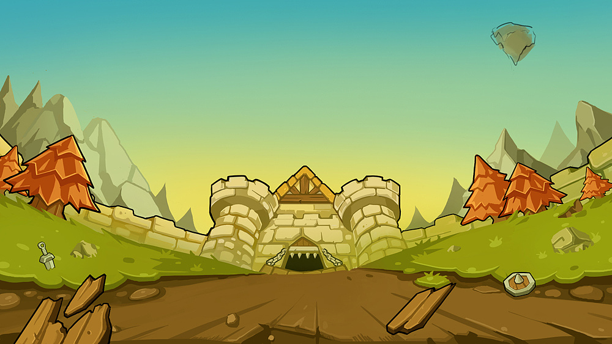
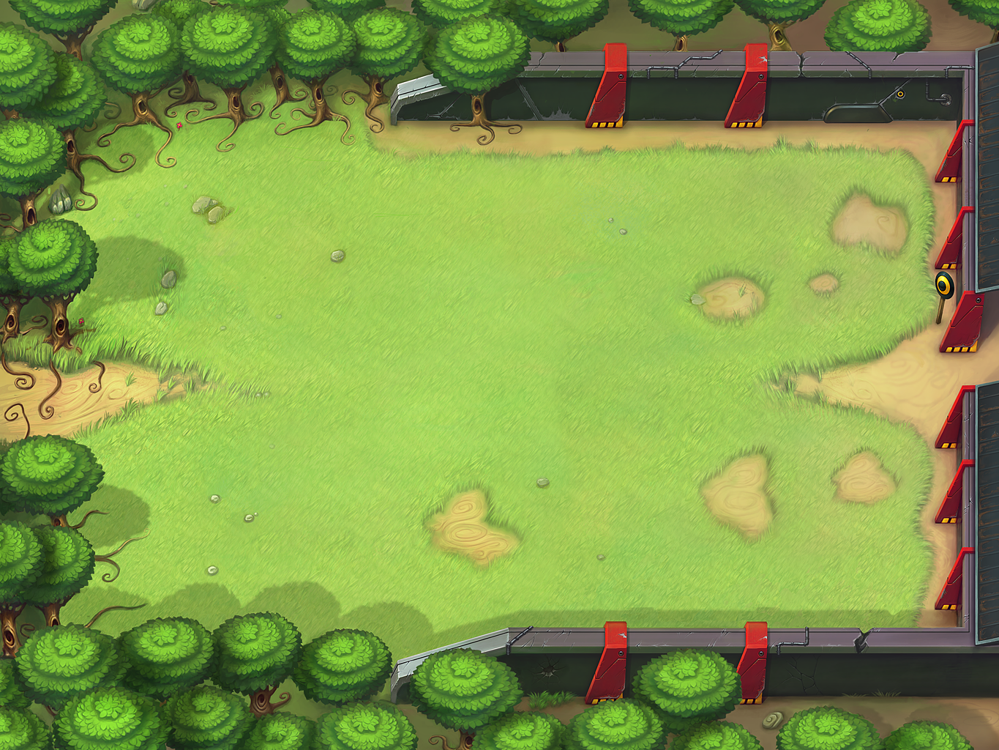
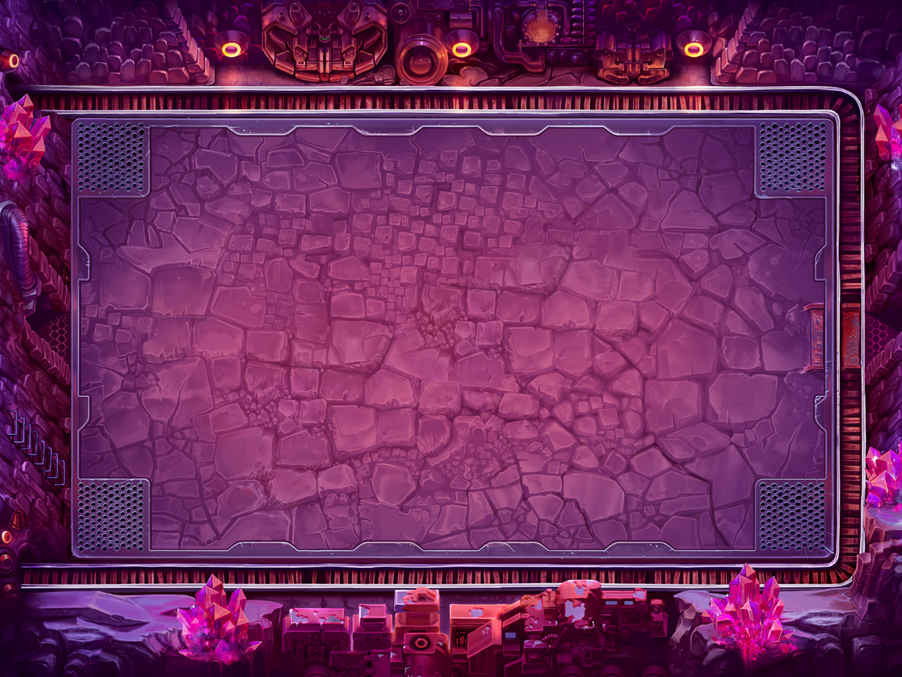

# Collapse: Tivat Canyon and Warriors

崩坏：提瓦特峡谷与勇士 —— A Roguelike mini-game independently developed in C++ with the EasyX graphics library.

## Overview

You play as a warrior fighting through multiple stages from scratch. Clear each stage, pick one random blessing (buff) to empower your run, and defeat the final boss to win.

- 4 stages + a multi-phase boss fight
- 9 random blessings (Roguelike-style buffs) to choose from after each stage
- Melee & ranged monsters with tracking AI
- 8-direction shooting + a 360° burst skill

## Controls

| Key | Action |
| --- | --- |
| W / S | Switch button (start menu) |
| Enter | Confirm |
| WASD | Move |
| ↑ ↓ ← → | Shoot |
| J | 360° burst skill |
| Space | Enter the portal |
| A / D | Switch blessing |

## Screenshots







## Tech Stack

- **Language**: C++ (Visual Studio 2022, v143 toolset)
- **Graphics**: [EasyX](https://easyx.cn) + GDI `AlphaBlend` for transparent sprite rendering, double buffering (`BeginBatchDraw` / `FlushBatchDraw`) to eliminate flicker
- **Audio**: Windows Multimedia API (`mciSendString`) for multi-track BGM switching
- **Input**: `GetAsyncKeyState` asynchronous keyboard polling
- **Architecture**:
  - Scene-based state machine: a `Scene` base class with virtual lifecycle hooks (`on_enter` / `on_input` / `on_update` / `on_draw` / `on_exit`), derived scenes for the start menu, 4 game stages, blessing selection, and win/lose endings
  - 60 FPS game loop with frame-time compensation
  - OOP entity design: `player`, `monster1` (melee), `monster2` (ranged), `boss` (3-phase bullet patterns), `bullet`, `wendy_bullet`, `door` classes
  - `std::vector` for dynamic bullet / monster management
  - AABB collision detection, vector-normalized tracking AI, frame-based sprite animation

## Build

1. Install [EasyX](https://easyx.cn) (the header `graphics.h` and its libs).
2. Open `GenshinImpact.sln` with Visual Studio 2022.
3. Build & run (x64).

Or simply run the pre-built `Genshin/Genshin.exe` (x64, Debug build) with the asset folders kept in place.

## Project Structure

```
GenshinImpact.sln
Genshin/
  main.cpp        # Entry: scene scheduling sequence
  scene.h         # Scene base class, game loop, stage & blessing-selection scenes
  player.h        # Player / bullet classes, shooting & movement
  monster.h       # Monster / boss classes, AI & bullet patterns
  start.h         # Start menu, background & blessing image classes
  else.h          # Portal class
  music.h         # BGM management via mciSendString
  image_test.h    # Image helpers
  background/ door/ enemy/ music/ player/ prop/   # Assets
  Genshin.exe     # Pre-built executable
```

## Note

The asset folders contain all sprites and music required by the game. Please do not move or delete them, otherwise unpredictable rendering issues may occur.
